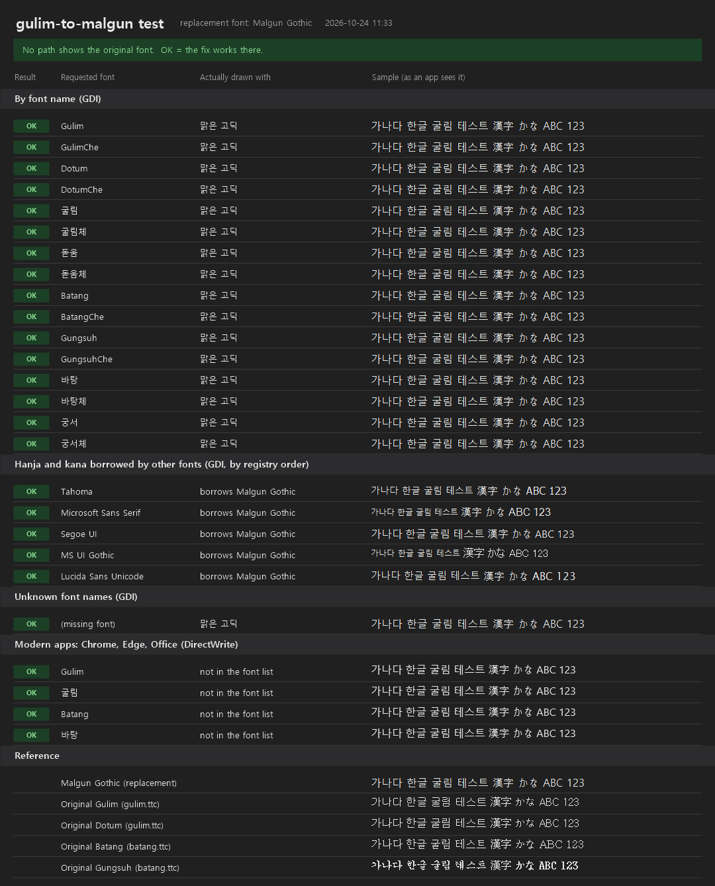

<h1 align="center">gulim-to-malgun</h1>

<p align="center">
  Make Gulim (굴림) render as Malgun Gothic (맑은 고딕) or another Korean font on Windows 11, even after updates.
</p>

<p align="center">
  
  
  <a href="LICENSE"></a>
</p>

<p align="center">
  <a href="https://github.com/KimHerV/gulim-to-malgun/releases/latest"></a>
</p>

## Features

- **Replaces Gulim everywhere:** also where the usual registry fix doesn't work, such as Hanja and
  Japanese text.
- **Stays fixed:** a startup task applies the fix again after Windows updates.
- **Fully reversible:** Uninstall puts back exactly what it changed.
- **Any Korean font:** Malgun Gothic by default, or another installed font such as NanumGothic.
- **Optional extras:** Batang and Gungsuh too, and one font for cmd and PowerShell windows.
- **Test window:** see which font each kind of app actually gets.



## Requirements

- Windows 11 with Korean fonts; nothing else to install. Other Windows versions haven't been tested.
- Administrator rights for Install and Uninstall. Test and Status don't need them.

## Install

1. Download the `.zip` file from the [latest release](https://github.com/KimHerV/gulim-to-malgun/releases/latest).
   Right-click it, choose Properties, tick **Unblock**, click OK, then extract it.
2. Double-click `gulim-to-malgun.cmd` and approve the administrator prompt.
   If Windows warns you, see [Security & Trust](#security--trust).
3. Choose `1`, then **restart Windows**.

## Usage

Run `gulim-to-malgun.cmd` again any time. The menu shows the current state at the top:

```
  [1] Install - Gulim only                Fix it now and keep it fixed at every startup
  [2] Install - Gulim + Batang/Gungsuh    Same, and replace Batang/Gungsuh too
  [3] Replacement font: Malgun Gothic     Choose the font that replaces Gulim

  [4] Test                                Open a window that shows the fix working
  [5] Status                              Text report of which font each Gulim name uses

  [6] Console font: Windows default       Optional: font for cmd and PowerShell windows

  [7] Uninstall                           Put everything back as it was
  [0] Exit                                (Enter alone redraws the menu)
```

## Parameters

| Option | Values | Default | What it does |
|---|---|---|---|
| `3` Replacement font | any installed font that covers Hangul, installed for all users | Malgun Gothic | Font used in place of Gulim |
| `6` Console font | Cascadia Mono or Consolas, with UTF-8 | Windows default | Font for cmd and PowerShell windows, for your account. Old programs that print Korean in the legacy encoding may show it garbled; `6` undoes it |

<details>
<summary>Command line</summary>

```powershell
powershell -ExecutionPolicy Bypass -File .\gulim-to-malgun.ps1 Install [-IncludeBatang] [-TargetFace "NanumGothic"]
powershell -ExecutionPolicy Bypass -File .\gulim-to-malgun.ps1 Uninstall
powershell -ExecutionPolicy Bypass -File .\gulim-to-malgun.ps1 Status
powershell -ExecutionPolicy Bypass -File .\gulim-to-malgun.ps1 Test [-OutFile result.png]
```

`-RemoveCapability` also uninstalls the optional Windows feature *Korean Supplemental Fonts*, which deletes
`gulim.ttc` and `batang.ttc` (and GulimChe, Batang, Gungsuh with them). Uninstall reinstalls it.

</details>

## What it changes

- Unregisters `gulim.ttc` from the Windows font list. The file stays.
- Points every Gulim name at the replacement font under `FontSubstitutes`.
- Puts Malgun Gothic ahead of Gulim in every `FontLink\SystemLink` chain.
- Records each original value first, in `C:\Program Files\gulim-to-malgun`.
- Registers a startup task, `gulim-to-malgun`, that runs as SYSTEM at startup and sign-in and re-applies only what an update has put back.

<details>
<summary>Why the usual fix isn't enough</summary>

Mapping Gulim to another font under `FontSubstitutes` alone doesn't work. Gulim reaches the screen three ways:

1. **By name.** While `gulim.ttc` is registered, Korean names such as `굴림` get the real Gulim
   whatever the substitutes say, and Chrome, Edge and Office ignore substitutes altogether.
2. **By font linking.** `FontLink\SystemLink` makes Tahoma, Microsoft Sans Serif and others borrow
   Hanja and kana from `GULIM.TTC`.
3. **By default face.** Unknown font names fall back to Gulim. Apps such as AMD Software draw Korean
   this way.

</details>

## Uninstall

Run `gulim-to-malgun.cmd`, choose `7`, then restart Windows. It puts back exactly the values it
recorded and removes the startup task. Any value it can't restore yet is kept for the next run.

## Security & Trust

- **The script is plain text.** Read `gulim-to-malgun.ps1` before running it if you like.
- **Unblock:** Windows marks downloaded files as coming from the internet. Unblocking the ZIP before
  extracting removes that mark from the extracted files, so Windows doesn't warn about them.
- **Execution policy:** `gulim-to-malgun.cmd` starts PowerShell with `-ExecutionPolicy Bypass` for that
  run only. Your execution policy is not changed.
- **Runs as administrator and installs a SYSTEM task.** Because of that, the script won't run as
  administrator from a folder other accounts can change; it quietly runs a protected copy from
  `%LOCALAPPDATA%\gulim-to-malgun\source` instead.
- **Check the download:** from v1.0.1, the release notes list the file's SHA-256. Compare it with
  `Get-FileHash .\gulim-to-malgun-*.zip -Algorithm SHA256`.

## Notes

- **Restart after installing or uninstalling.** Windows reads font settings when the session starts.
- **Small text looks heavier than Gulim.** Gulim has hand-drawn bitmaps for small sizes; Malgun
  Gothic doesn't.
- **Fixed-width text may shift,** since GulimChe and DotumChe were fixed-width and Malgun Gothic isn't.
- **Web pages** that ask for Gulim get the browser's default font instead.

## 한국어

윈도우 11에서 굴림(굴림체·돋움·돋움체 포함)을 맑은 고딕으로 바꿔 보이게 하는 도구입니다. 바탕·궁서도
함께 바꿀 수 있고, 나눔고딕 등 설치된 다른 한글 글꼴을 고를 수도 있습니다. 업데이트 후 굴림이 다시
나타날 때, 한자·일본어만 굴림으로 보일 때, 프로그램 글꼴(폰트)이 굴림으로 나올 때 쓰세요. 글꼴
대체(FontSubstitutes)와 글꼴 연결(SystemLink)을 함께 고치고, 부팅할 때마다 다시 적용합니다.

1. [최신 릴리스](https://github.com/KimHerV/gulim-to-malgun/releases/latest)에서 `.zip` 파일을 받습니다.
   파일을 오른쪽 클릭 → 속성 → **차단 해제**에 체크한 뒤 압축을 풉니다.
2. `gulim-to-malgun.cmd`를 더블클릭하고 관리자 권한 요청을 승인합니다.
3. `1`을 고른 뒤 **윈도우를 다시 시작**합니다.
4. `4`를 고르면 바뀐 글꼴을 확인할 수 있습니다.
5. 되돌리려면 `7`을 고른 뒤 다시 시작합니다.

`.cmd`는 이번 실행에만 실행 정책을 우회하고, 설정은 바꾸지 않습니다. 다른 윈도우 버전은 테스트하지 않았습니다.

## License

[MIT](LICENSE) © 2026 KimHerV
